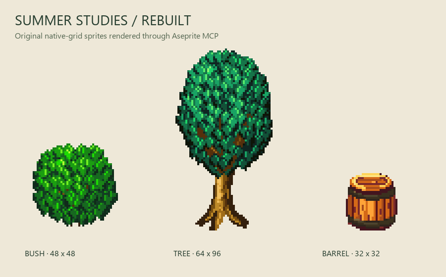

# Aseprite Gen

Original layered pixel sprites from a persistent reference-derived style profile, rendered by **real Aseprite through MCP**. Includes a reusable Codex skill, local reference analysis, art-directed generation, visual review, targeted layer refinement and export.



The first examples were rejected for a style mismatch. The current [summer revision](examples/summer-v2/index.html) rebuilds their silhouettes, leaf structure and material ramps; [this comparison](examples/summer-v2/comparison.png) preserves the rejected version alongside the new original artwork.

The first release supports static **bushes, broadleaf trees and barrels**. It combines bounded procedural construction with Codex visual reasoning and editable scene operations. It does not train model weights or provide unrestricted local text-to-image generation. The saved style grammar makes the workflow reusable across chats.

## Windows quick start

Requirements: Python 3.11+, Git, and Aseprite. To build the editor, install Visual Studio 2022 Build Tools with Desktop development with C++, a Windows SDK and the CMake component. Node.js 20+ is needed only for Ruflo.

```powershell
git clone https://github.com/sightless-dev/aseprite-gen.git
cd aseprite-gen
powershell -ExecutionPolicy Bypass -File scripts/setup.ps1 -BuildAseprite
.\.venv\Scripts\python.exe -m aseprite_gen.cli generate "berry bush" --seed 7 --name my-bush
.\.venv\Scripts\python.exe -m aseprite_gen.cli review output/my-bush.aseprite --output output
```

The build uses verified official archives from [aseprite/aseprite](https://github.com/aseprite/aseprite). The tested result is **Aseprite 1.3.18.6-dev**, Skia backend, at `.local/aseprite/build/bin/aseprite.exe`. See [build provenance and prerequisites](docs/aseprite-build.md). To use an existing installation, set `ASEPRITE_PATH` and omit `-BuildAseprite`.

For the exact tested Windows Python dependencies, install `requirements-windows.lock` before `pip install -e . --no-deps`. No cloud image API key is required. All sprite drawing runs locally in Aseprite; the Codex agent supplies visual reasoning when using the skill.

## Use the Codex skill

Open this repository in Codex and invoke:

```text
Use $aseprite-pixel-artist to analyze Reference, create an original autumn bush,
review it at native resolution, and refine the layered source.
```

The discoverable skill is [.agents/skills/aseprite-pixel-artist/SKILL.md](.agents/skills/aseprite-pixel-artist/SKILL.md). It supports **ANALYZE, GENERATE, REVIEW, REFINE, VARIATIONS and EXPORT**, and automatically reads the saved profile. It was initialized and validated with OpenAI's official `skill-creator`, then forward-tested in an isolated output folder.

[MCP setup and exact tool schemas](docs/mcp.md) explain direct client connection. The CLI already starts a real stdio MCP client/server for every rendering operation, so it works without refreshing the current chat's tool inventory.

## Commands

```powershell
# Private analysis: immutable hashed snapshots, contact sheets, palettes, metadata
.\.venv\Scripts\python.exe -m aseprite_gen.cli analyze Reference

# Bounded text modifiers: autumn, berries, young, weathered; Russian equivalents
.\.venv\Scripts\python.exe -m aseprite_gen.cli generate "old oak tree" --seed 7 --name oak
.\.venv\Scripts\python.exe -m aseprite_gen.cli generate "weathered barrel" --size 32 32 --name cask
.\.venv\Scripts\python.exe -m aseprite_gen.cli variations "autumn berry bush" --count 3 --name autumn

# Author/edit a plan before rendering other geometry
.\.venv\Scripts\python.exe -m aseprite_gen.cli plan "tree" --output output --name custom
.\.venv\Scripts\python.exe -m aseprite_gen.cli render output/custom.scene.json --name custom-render

# An operations file is a JSON array using the documented scene grammar
.\.venv\Scripts\python.exe -m aseprite_gen.cli refine output/oak.aseprite corrections.json --layer "art direction" --name oak-v2
.\.venv\Scripts\python.exe -m aseprite_gen.cli export output/oak-v2.aseprite --name oak-release
```

Each generation saves named layers in `.aseprite`, a transparent native PNG, scene JSON, generation metadata and a nearest-neighbor preview. Existing names are preserved: use a new name for each revision. The native dimensions default to 48×48, 64×96 and 32×32 respectively; requested sizes retain the construction's aspect ratio within the canvas. Profile schema 2 controls canopy dimensions, leaf spacing and leaf sizes as well as colors. Schema-1 profiles must be updated; historical scene JSON remains renderable.

`--references Reference` adds private reference-selection metadata. Do not publish that metadata. Without it, generation uses the persisted profile; no source pixels are copied into the output. Seed variation changes cluster placement or grain/bung details; stronger shape variation requires editing the scene.

## Evidence and limits

- **Analysis:** all 495 PNGs were opened in 21 overview sheets; relevant native atlases and enlarged crops received detailed inspection. 507 JSON sidecars were parsed and 12 TBIN maps inventoried. TBIN decoding and per-frame inspection of every atlas are not implemented.
- **Style:** [profile](profiles/cozy-rpg.json) and [guide](docs/style-guide.md) separate observations, hypotheses and contradictions. UI, effects and recolor masks are excluded from the primary prop profile.
- **Art:** the rejected bush, tree and barrel were rebuilt through Aseprite and compared with selected reference objects at the same pixel scale. [Before/after comparison](examples/summer-v2/comparison.png), [current gallery](examples/summer-v2/index.html), and [visual findings](docs/visual-review.md) preserve evidence. Leaf placement remains more regular and bark/grain simpler than the references. Model self-review is not human approval.
- **Aseprite:** actual native tests verified exact pixels, palette, alpha, layers, one-pixel refinement, source preservation and round-trip export. A GUI-capable binary was built; manual GUI operation was not tested.
- **Ruflo:** version 3.72.1 was really used through MCP for persistent roles, task state and shared memory. Codex executed the workers; Ruflo registrations alone did not execute LLMs. See [the verified boundary](docs/ruflo.md).

## Tests

```powershell
.\.venv\Scripts\python.exe -m pytest -q
```

The initial Windows verification passed **33 tests**, including four actual Aseprite integration tests, with no runtime skips. The summer correction passed **11 focused generation tests**, including actual Aseprite source reopening, with no skips. CI runs unit and MCP transport tests on Windows and Linux; native editor tests require Aseprite and are excluded there. Pillow emits deprecation warnings for `getdata()`; dependency bounds exclude the release that removes it.

## Project map

| Path | Purpose |
|---|---|
| `src/aseprite_gen/analysis.py` | Private inventory, grid measurements, sheets and reference selection |
| `generation.py`, `drawing.py`, `profiles/` | Reusable geometry grammars, semantic options and style rules |
| `aseprite.py`, `mcp_server.py`, `protocol.py` | Real editor backend, MCP server and client |
| `validation.py`, `cli.py` | Technical image checks and end-to-end commands |
| `.agents/skills/aseprite-pixel-artist/` | Codex skill and editing reference |
| `examples/` | Original native PNGs, editable sources, scenes and before/after evidence |
| `scripts/` | Windows build/setup, gallery and pinned Ruflo MCP bridge |

## Publication and licensing

`Reference/`, derived reference imagery, `.local/` build products, local configuration and credentials are ignored. The public examples are original project outputs. Aseprite and its dependencies are not redistributed and retain their upstream terms. No project-wide legal license has been selected; the repository owner must make that choice before users rely on a redistribution grant.
